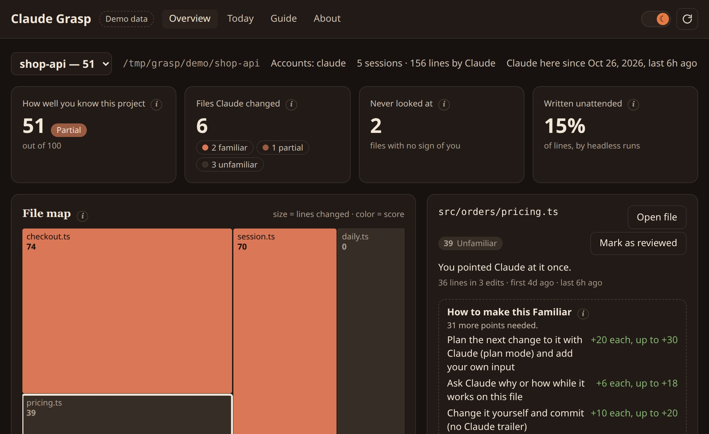
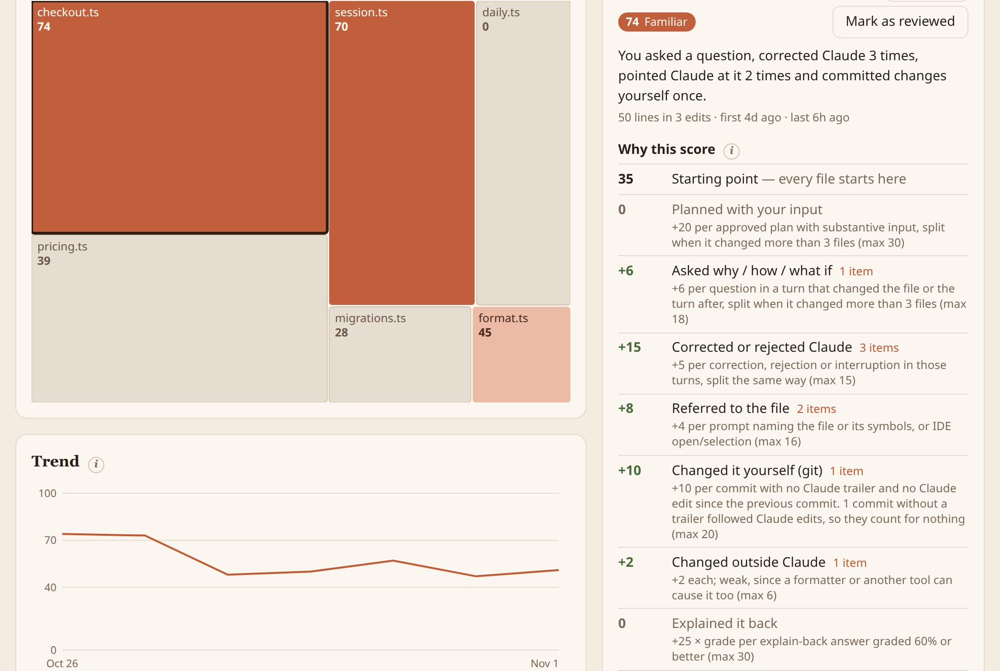
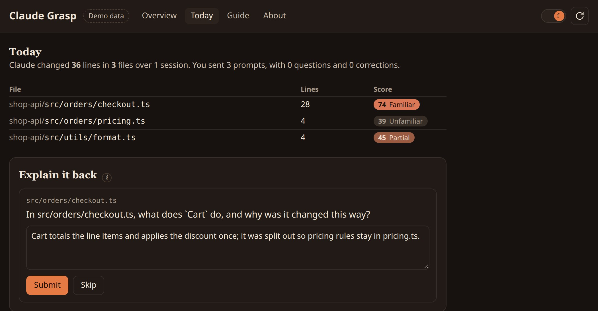

# Claude Grasp

**How well do you understand the code Claude Code wrote for you?**

Claude Grasp reads your Claude Code sessions and your git history, and gives every file Claude
changed a score from 0 to 100 for how much *you* engaged with it: the plans you shaped, the
questions you asked, the corrections you made, the commits you wrote yourself. Every point is
explained, and each file tells you what would turn it green.

Everything runs on your machine. No account, no telemetry.

- 🟢 **70–100 Familiar.** You clearly engaged with this code.
- 🟡 **40–69 Partial.** Some engagement; worth a closer look before you change it.
- 🔴 **0–39 Unfamiliar.** Claude wrote it and little shows that you know how it works.



## Features

- **Dashboard** (`Claude Grasp: Open Dashboard`)
  - Project score, files by bucket, files you never looked at, share written unattended. Every tile has an ⓘ explaining it.
  - **File map**: one block per file, sized by lines Claude changed, colored by score. Click a block or a bucket to filter.
  - **Trend** of the project score, a **Start here** list and a searchable, sortable file table.
  - **Why this score**: every point behind a file's score, with the evidence (prompts, plans, commits) behind it.
  - **How to make this green**: which actions would raise the file's score, and by how much.
  - **Today**: what Claude changed today, plus the optional explain-back question.
  - **Guide** and **About** tabs; Auto / Light / Dark theme.
  
- **Activity bar view**: your projects with their scores; files lowest score first.
- **Explorer badges** and a **status bar** score for the file you have open.
- **Several Claude accounts**: reads every `~/.claude*` config folder (e.g. `~/.claude` and `~/.claude-work`), with an account filter on the dashboard.
- **Demo**: `Claude Grasp: Open Demo (sample data)` shows a sample project, without touching your data.

## Requirements

- VS Code 1.101 or newer (Claude Grasp uses the SQLite built into VS Code's Node runtime).
- Claude Code, used in at least one git repository.
- For the optional quiz: the `claude` command line tool, signed in.

## Getting started

1. Install **Claude Grasp** from the Marketplace.
2. Click the Claude Grasp icon in the activity bar. Your projects appear after the first read (a few seconds).
3. Open the dashboard and click any file to see why it scored what it did.

Claude Grasp reads new sessions every 5 minutes and when you press **Refresh**.

## Penalties: you decide

People work differently. Many keep auto-accept on and type "continue" all day, and that doesn't
mean they don't understand the code. So every penalty except unattended edits is **off by
default**. Turn on the ones that match how you want to be measured:

| Setting | Default | Strict | What it measures |
| --- | --- | --- | --- |
| `claudeGrasp.penalties.unattended` | 35 | 35 | Lines written by headless `claude -p` runs nobody watched |
| `claudeGrasp.penalties.bareApproval` | 0 | 20 | Turns that changed the file started with only "ok", "continue", "yes" |
| `claudeGrasp.penalties.autoAccept` | 0 | 10 | Lines accepted by auto-accept, allow rules or bypass mode |
| `claudeGrasp.penalties.codeVolume` | 0 | 15 | Lots of code for few of your words (none up to 3 lines per word, all at 15) |
| `claudeGrasp.penalties.failedQuiz` | 0 | 10 | Per quiz answer graded below 60% |

Each penalty is scaled by the share of the file it applies to. A penalty that is off shows as
"Off" in the breakdown and never counts.

## The explain-back quiz (optional)

Off by default. Turn it on with `claudeGrasp.quiz.enabled`. Once a day Claude Grasp picks one
of today's files, favouring big changes and low scores, and your own `claude -p` writes a short
why/how question about that diff, along with key points a good answer should cover (hidden
until you answer). You answer in a sentence or two; `claude -p` grades it 0–100% against the
diff and the key points. 60% or more adds up to +25 to that file.

**Skipping is always free.** A low grade costs nothing unless you turn on the failed-quiz penalty.



## Settings

| Setting | Default | Description |
| --- | --- | --- |
| `claudeGrasp.configDirs` | `[]` | Claude Code config folders to read. Empty: every `~/.claude*` folder |
| `claudeGrasp.quiz.enabled` | `false` | Turn on the daily explain-back quiz |
| `claudeGrasp.quiz.questionsPerDay` | `1` | Questions per day (1–5) |
| `claudeGrasp.quiz.reminder` | `true` | A small daily notification offering the question |
| `claudeGrasp.quiz.disabledConfigDirs` | `[]` | Accounts whose code must never go to `claude -p` |
| `claudeGrasp.claudePath` | `""` | Full path to `claude`, if it isn't found automatically |
| `claudeGrasp.model` | `""` | Model for the quiz (`claude -p --model`). Empty: the account's default |
| `claudeGrasp.penalties.*` | see above | Penalty weights |
| `claudeGrasp.explorerBadges` | `true` | Score badges in the Explorer and on editor tabs |
| `claudeGrasp.refreshIntervalMinutes` | `5` | How often to read new sessions. `0`: startup and Refresh only |

## How a score is calculated

```
raw   = 35 (base) + positive signals − time decay − penalties
score = round(clamp(raw, 0, 100))
```

"Engaged turns" for a file are the turns that edited it, the turns where you rejected an edit to
it, and the turn right after each of those.

| You… | Points | Up to |
| --- | --- | --- |
| Approved a plan you shaped (edited it, wrote 15+ words, or asked/answered something) | +20 | 30 |
| Asked why / how / what if in an engaged turn | +6 | 18 |
| Corrected or rejected Claude, or interrupted it | +5 | 15 |
| Named the file or one of its functions, or had it open in the IDE | +4 | 16 |
| Changed and committed it yourself (no Claude trailer, no Claude edit since the last commit) | +10 | 20 |
| Changed it outside Claude (weak signal: could be a formatter) | +2 | 6 |
| Marked it reviewed after Claude changed it (CodeLens above the file, or the dashboard) | +8 | 16 |
| Explained it back in the quiz (scaled by the grade) | +25 | 30 |

Plan, question and correction credit from a turn that changed more than 3 files is split
between them (a turn that changed 6 files gives each half), unless your prompt named the file.

Positive evidence halves in value every 30 days but keeps at least a quarter of it; the breakdown
shows the loss as its own line, so the numbers always add up. The project score is the average of its files, weighted by lines
changed. **Never looked at** means no positive evidence at all.

Deleted files, files git ignores, and lockfiles, bundles, source maps and snapshots never get a
score. Add your own globs with `claudeGrasp.ignore`.

Headless `claude -p` sessions that edit files are marked *unattended*: they earn no engagement
credit and carry the unattended penalty. Headless sessions that only read are ignored.

## Privacy

- **Read-only.** Claude Grasp only reads your Claude Code sessions (`~/.claude*`) and your
  repositories' git history, and never changes them. Its own database lives in VS Code's storage
  for this extension.
- **No telemetry, no network calls.** The only exception is the optional quiz, which runs your
  own `claude -p`: the selected diff and your answer go to Anthropic under **the same account
  that wrote that code**, never another one. Use `claudeGrasp.quiz.disabledConfigDirs` to keep an
  account out of the quiz entirely.
- `claude -p` runs with no tools, no MCP servers, no session saving and no user or project
  settings (so none of your hooks run), from Claude Grasp's own folder. Claude Grasp never reads
  its own calls back as sessions. When the quiz runs, Claude Code itself creates an empty
  `projects/…-llm-workdir/memory/` folder for that workdir in the account it was called for.

## Built by Asyncript

Claude Grasp is a project of [Asyncript](https://marketplace.visualstudio.com/publishers/Asyncript).
If it helps you, please [rate or review it on the Marketplace](https://marketplace.visualstudio.com/items?itemName=Asyncript.claude-grasp&ssr=false#review-details).

Claude Grasp is an independent tool that works with Claude Code. It is not made or endorsed by Anthropic.

## Building from source

Needs Node 22.13+ (see `.nvmrc`).

```sh
npm install
npm run check        # typecheck, lint, tests, smoke, build, package listing
npm run dev -- --demo  # dashboard in a browser at http://127.0.0.1:5174 with sample data
npm run package      # claude-grasp-<version>.vsix
```

Press **F5** in VS Code to run the extension in an Extension Development Host.
# claude-grasp
